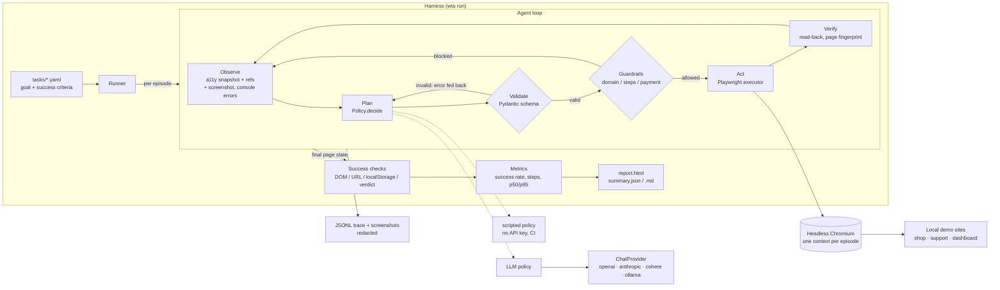

# web-task-agent

A small browser agent built to be **reliable, observable and measured**. It completes multi-step
tasks on websites (search, cart, checkout, login, ticket forms) and runs QA checks
("does the export button actually work?"). A harness decides whether each run succeeded by
looking at the real page state, not at what the agent says.

[](.github/workflows/ci.yml)
Python 3.12 · async Playwright · Pydantic · Typer · MIT

> **About the numbers.** Every number in this README was produced by running the code in this
> repository. The results below come from the deterministic **`scripted`** policy, which needs no
> API key and is what CI runs. Those numbers show that the harness works: browser control,
> snapshots, guardrails, success checks, tracing and reporting. **They say nothing about how good
> a model is.** No LLM results are published yet; `make eval PROVIDER=…` produces them with your
> own key.

---

## The problem

Browser agents fail in quiet ways. They click the wrong element, type into a stale field, say
"done ✅" when nothing happened, or wander to a domain they should never touch. Before an agent
like this can automate real workflows or act as a website QA tester, you need four things:

1. **A small, auditable action space** that the model cannot get around.
2. **Verification after every action** ("did that click change anything?").
3. **Success decided by the harness**, from the DOM and storage, independent of the agent's claim.
4. **Traces and metrics**: success rate, steps, and p50/p95 latency per task, plus the reason for each failure.

This repo is a compact reference implementation of these four things. It runs against bundled
fictional websites.

## Architecture



| Module | Responsibility |
|---|---|
| `wta/actions.py` | Pydantic discriminated union of 9 actions; tolerant JSON extraction; precise error messages |
| `wta/snapshot.py` | In-page DOM walk that produces a compact role/name/value list and tags elements with `data-wta-ref` |
| `wta/browser.py` | Isolated browser context; executes actions; verifies effects; captures console errors; masked screenshots |
| `wta/guardrails.py` | Domain allow-list (navigation **and** every network request), step budget, payment-field policy |
| `wta/redact.py` | `{{secret:name}}` placeholders, secret/API-key/card-number redaction |
| `wta/policies/` | `ScriptedPolicy` (deterministic reference) and `LLMPolicy` (prompting, re-asking on invalid output) |
| `wta/providers/` | One `ChatProvider` interface over plain `httpx`: OpenAI, Anthropic, Cohere, Ollama |
| `wta/agent.py` | The observe → plan → act → verify loop, tracing every step |
| `wta/checks.py` | Success criteria evaluated by the harness on the final page |
| `wta/runner.py`, `report.py`, `cli.py` | Suite runner, aggregation (p50/p95), HTML/JSON/Markdown reports, Typer CLI |

## Quickstart (3 commands)

```bash
uv sync --extra dev                    # Python 3.12 venv + deps (pip install uv first if needed)
uv run playwright install chromium     # or set WTA_CHROMIUM_EXECUTABLE to an existing Chromium
uv run wta run tasks/ --report out/    # 10 tasks, scripted policy, no API key -> out/report.html
```

With a model (keys go in `.env`; see `.env.example`):

```bash
uv run wta run tasks/ --policy llm --provider anthropic --repeat 3 --report out/anthropic
uv run wta run tasks/ --policy llm --provider ollama --model qwen2.5:7b --no-vision
```

Other commands: `wta list`, `wta validate`, `wta serve` (opens the demo sites at
http://127.0.0.1:8765 so you can click through them yourself), and `make check` (lint, types and tests).
Docker: `docker build -t web-task-agent . && docker run --rm web-task-agent`.

## The demo sites and the task suite

`sites/` holds three static, fictional sites. During runs and tests, a local thread serves them on
`127.0.0.1` at a random port.

* **Northwind Gear shop**: search, a sort dropdown, product pages with quantity, cart in
  localStorage, and a checkout form with validation (email, Luhn check on test cards, expiry, CVC).
* **Helpdesk support portal**: login checked against `sites/support/demo_users.json` (fictional
  credentials) and a ticket form with select, radio buttons and validation.
* **Ops Metrics dashboard**: the range filter and the Refresh button work. **Export CSV contains a
  deliberate regression**: the handler calls a function that was renamed, throws a `TypeError`,
  and the user gets no feedback.

`tasks/` has 10 scenarios: 6 automation and 4 QA. For QA tasks, `done.success` is the agent's
*verdict* on the site, and the harness compares that verdict to the known ground truth.

| # | Task id | Kind | What the harness checks (independently of the agent) |
|---|---|---|---|
| 1 | `shop-find-kettle-under-price` | automation | URL is the €34.90 kettle's page; agent names the product |
| 2 | `shop-cheapest-headphones-to-cart` | automation | `localStorage.nw_cart` holds exactly 1 × `p-104` |
| 3 | `shop-add-quantity` | automation | cart holds 2 × `p-301`; header shows `Cart (2)` |
| 4 | `shop-checkout-test-card` | automation | "Order confirmed" visible; stored order has the right item and card last-4 `4242` |
| 5 | `shop-checkout-email-validation` | qa | verdict = pass; email error visible; **no** order stored |
| 6 | `support-login` | automation | on `tickets.html`; "Signed in as demo.agent"; session stored |
| 7 | `support-submit-ticket` | automation | ticket row with the subject; category Billing; priority High; agent reports `TCK-1001` |
| 8 | `support-wrong-password-rejected` | qa | verdict = pass; error visible; still on login; no session |
| 9 | `dashboard-export-regression` | qa | verdict = **fail** (bug found); "Export ready" absent; summary names the export |
| 10 | `dashboard-refresh-and-range` | qa | verdict = pass; `#last-updated` and `#kpi-users` changed as specified |

An episode **passes only if** the agent calls `done` within its step budget **and** every
criterion holds.

## Results

Produced by `wta run tasks/ --policy scripted --repeat 3 --report out --min-success 1.0`
(`make demo`) on 2026-11-19, in a 2-vCPU Linux container with headless Chromium 153 and Python 3.12.3.
This is the content of `out/summary.md`, unedited:

Policy: `scripted` · 30 episodes · success 30/30 (100%) · p50 1.43s · p95 2.75s

| Task | Kind | Success | Mean steps | p50 (s) | p95 (s) |
|---|---|---|---|---|---|
| `shop-find-kettle-under-price` | automation | 3/3 (100%) | 5 | 1.22 | 1.24 |
| `shop-cheapest-headphones-to-cart` | automation | 3/3 (100%) | 7 | 2.18 | 2.19 |
| `shop-add-quantity` | automation | 3/3 (100%) | 7 | 1.65 | 1.69 |
| `shop-checkout-test-card` | automation | 3/3 (100%) | 13 | 2.76 | 2.77 |
| `shop-checkout-email-validation` | qa | 3/3 (100%) | 7 | 1.06 | 1.09 |
| `support-login` | automation | 3/3 (100%) | 5 | 0.85 | 0.88 |
| `support-submit-ticket` | automation | 3/3 (100%) | 11 | 2.60 | 2.66 |
| `support-wrong-password-rejected` | qa | 3/3 (100%) | 6 | 0.91 | 1.01 |
| `dashboard-export-regression` | qa | 3/3 (100%) | 3 | 2.61 | 2.65 |
| `dashboard-refresh-and-range` | qa | 3/3 (100%) | 5 | 0.92 | 0.94 |

How to read this:

* **100% is the expected result for the scripted policy.** Its plans are written by hand, as
  role and name targets resolved against the live snapshot. A pass means the snapshot, executor,
  guardrails and success criteria agree with each other. It does **not** measure reasoning.
* Durations include a screenshot per step and the deliberate waits. The export check spends 2 s
  in `wait_for` before it concludes the confirmation never appears.
* The test suite also proves the harness can **fail** episodes: a false success claim fails on
  URL/DOM checks; a "looks fine" verdict on the broken export fails `agent_verdict`; a step budget
  of 3 ends the episode as `max_steps`; and a checkout without payment opt-in records 3 guardrail
  blocks and fails (see `tests/test_scripted_e2e.py`).
* LLM numbers: **not measured yet.** This environment had no API keys, so nothing is reported.

## Example run log

Console (`wta run`, abridged):

```text
Running 10 task(s) x 3 with policy scripted
PASS shop-find-kettle-under-price r1  steps=5  1.22s  status=completed
PASS shop-find-kettle-under-price r2  steps=5  1.16s  status=completed
...
PASS dashboard-export-regression r1  steps=3  2.66s  status=completed
...
Success rate: 30/30 (100%)  p50=1.43s p95=2.75s  tokens in/out=0/0  invalid=0  blocked=0  wall=55.2s
Report: out/report.html
```

What the agent "sees" on the dashboard (the compact snapshot that goes into the prompt):

```text
URL: http://127.0.0.1:34931/dashboard/index.html
Title: Ops Metrics – Dashboard
...
[e4] heading "Weekly overview" level=1
[e5] toolbar "Dashboard actions"
[e6] combobox "Range" value="Last 7 days" options=Last 7 days|Last 30 days
[e7] button "Refresh data"
[e8] button "Export CSV"
[e9] status "Last updated: never"
[e10] text "Active users"
[e11] text "1,284"
...
```

How the regression gets caught (`out/traces/dashboard-export-regression__r1.jsonl`, condensed):

```text
step 1  click e8 (Export CSV)        -> OK, effect=no_visible_change
step 2  console: "pageerror: window.buildCsv is not a function"
        wait_for "Export ready" 2s   -> did NOT appear (assertion=false)
step 3  done(success=false, "Export CSV check -> text 'Export ready' did NOT appear within
        2000 ms | console: pageerror: window.buildCsv is not a function")
harness: agent_verdict ok (expected false) · text_absent ok · summary_mentions ok -> PASS
```

One trace record, with a few fields trimmed. Note that the password is logged as its placeholder:

```json
{"event": "step", "task_id": "support-login", "step": 2,
 "observation": "'Helpdesk – Sign in' http://127.0.0.1:41869/support/login.html | 6 nodes (textbox=2, link=1, heading=1, form=1, button=1)",
 "thought": "plan step 2/5: fill -> textbox 'Password' = e5",
 "action": {"type": "fill", "ref": "e5", "text": "{{secret:support_password}}"},
 "result": {"ok": true, "message": "filled e5", "blocked_by": null, "effect": null, "assertion": null},
 "latency_ms": {"observe": 71.9, "policy": 0.1, "act": 26.9},
 "tokens": {"prompt": 0, "completion": 0},
 "screenshot": "screenshots/support-login/r1_step02.png"}
```

Each run writes the following to `--report`:

* `report.html`: summary tiles, a per-task table and the failures with reasons. Each episode
  expands to show the agent's claim next to the harness checks, plus a per-step observation,
  action, result, latency and screenshot.
* `summary.json`, `summary.md`
* `traces/<task>__r<n>.jsonl`
* `screenshots/<task>/r<n>_stepNN.png`

## Safety and guardrails

The harness enforces these rules. The model is told about them but cannot override them.

| Guardrail | How it is enforced |
|---|---|
| **Domain allow-list** (default `localhost`, `127.0.0.1`) | `goto` URLs are resolved and checked: only `http(s)`, so no `file:` or `javascript:`, and suffix tricks like `localhost.evil.com` are rejected. The browser context also routes **every request** (scripts, XHR, images) through the same check, which aborts and logs anything else. Tested with a `fetch()` exfiltration attempt. |
| **Step budget** | `max_steps` per task (overridable with `--max-steps`). An episode that runs out is a failure with status `max_steps`. |
| **Invalid-action budget** | The LLM gets the validation error and up to 3 re-asks per step, then the episode ends as `policy_error`. Invalid attempts are counted in the trace and the report. |
| **Payment fields** | Before any `fill`, the field is classified from the live DOM (`autocomplete=cc-*`, name, id, label: card, CVC, expiry, IBAN…). Filling one is **refused** unless the task sets `allow_test_payment_data: true`. Even then, only well-known public test card numbers such as `4242 4242 4242 4242` are accepted. |
| **Secrets** | Credentials live in fixture files and appear in goals only as `{{secret:name}}`. Substitution happens inside the executor, so the model never sees the value and the trace logs the placeholder. |
| **Redaction** | Every trace record passes through a redactor: known secrets, any `*KEY*`/`*TOKEN*`/`*SECRET*`/`*PASSWORD*` environment value, and card-number-like digit runs (masked to the last 4). Values typed into password or payment fields are logged as `[REDACTED:…-field]`. The snapshot shows password values as `••••`, and screenshots mask password and `cc-*` inputs. |
| **Isolation** | One fresh browser context per episode (no shared cookies or storage), headless by default. |

These guardrails are scoped to a demo. A production deployment would add a human-in-the-loop
confirmation step for irreversible actions, per-site policies, and rate limits.

## Design decisions

* **Refs from an accessibility-style snapshot, not CSS selectors or pixel coordinates.** The model
  picks from a short list (`[e8] button "Export CSV"`). That keeps the action space small, cuts
  prompt tokens from tens of thousands for raw HTML to a few hundred, and makes every action
  auditable. Refs are re-assigned on each observation, so a stale ref fails loudly instead of
  clicking the wrong element. Screenshots are optional extra context for vision models.
* **Verify after acting.** `fill` and `select` read the value back. `click` and `press` compare a
  fingerprint of the perceivable page before and after, and report `no_visible_change`. That one
  signal, plus console errors, is enough for a model to notice a dead button instead of claiming
  success.
* **The harness, not the agent, decides success.** Criteria are declarative (URL, visible or
  absent text, selector text, localStorage JSON paths, verdict, summary keywords) and evaluated on
  the final page. Agents misreport success often enough that this is not optional.
* **QA is a first-class task type.** "Check the site behaves as expected" is modelled as a verdict
  with ground truth. The suite includes both a real bug and working features, so it can measure
  missed detections *and* false alarms.
* **A deterministic scripted policy.** It runs the whole stack in CI in about a minute with no key
  and no flakiness from model sampling. It goes through the same `parse_action` validation as LLM
  output, so plans cannot bypass the schema.
* **Providers over plain `httpx`, not SDKs.** There is one `ChatProvider.complete()` interface.
  The request and response mapping for OpenAI, Anthropic, Cohere and Ollama is explicit and
  unit-tested with mock transports. Token usage is normalised. Images are sent only when the
  model supports vision, or never with `WTA_VISION=0`.
* **Observability from day one.** Each step is a JSONL record (observation summary, thought,
  action, result, latency split into observe/policy/act, tokens, screenshot), so a regression in
  success rate can be traced to a specific step.

## Tests and quality gates

`make check` runs `ruff check`, `ruff format --check`, `mypy --strict` and `pytest`. The pytest
suite has 83 tests. Most launch headless Chromium against the bundled sites.

* action schema validation: 12 rejection cases with their messages, defaults and bounds
* guardrails: blocked domains and schemes, network-level blocking, step budget, payment policy,
  redaction, secret placeholders
* snapshot builder: roles and names, password masking, hidden elements, ref tagging and refresh,
  truncation, fingerprints
* the executor's effect detection on the real dashboard regression
* **all 10 tasks solved end-to-end by the scripted policy**, plus negative cases (false claim,
  wrong verdict, `max_steps`, payment block, no secret in the trace)
* the LLM policy with a fake provider: re-asking on invalid output, give-up, vision gating,
  prompt hygiene, and a full browser episode through the LLM code path
* provider payloads and parsing for all 4 vendors, retry and error handling
* report generation: HTML, JSON and Markdown, p50/p95 math

CI (`.github/workflows/ci.yml`) runs all of the above, then the scripted suite 3 times with
`--min-success 1.0`, and uploads `out/` as an artifact.

## Roadmap

* Publish real LLM results per provider/model (success, steps, tokens, cost) with `--repeat ≥ 5`
  and confidence intervals; add pass^k to measure consistency.
* Recovery strategies: automatic re-observe on stale refs, back-off on `no_visible_change`, and
  plan-level critique.
* Harder sites: iframes, shadow DOM, pop-ups and new tabs, infinite scroll, flaky network, and A/B
  layout variants to test robustness to UI drift.
* Set-of-marks visual grounding for canvas-heavy UIs where the DOM is not enough.
* Parallel episodes, Playwright trace (`trace.zip`) export, and OpenTelemetry spans.
* Human-in-the-loop approval for irreversible actions, and per-domain policy files.

## License

MIT. See [LICENSE](LICENSE). All sites, products, users and data in this repository are
fictional.
